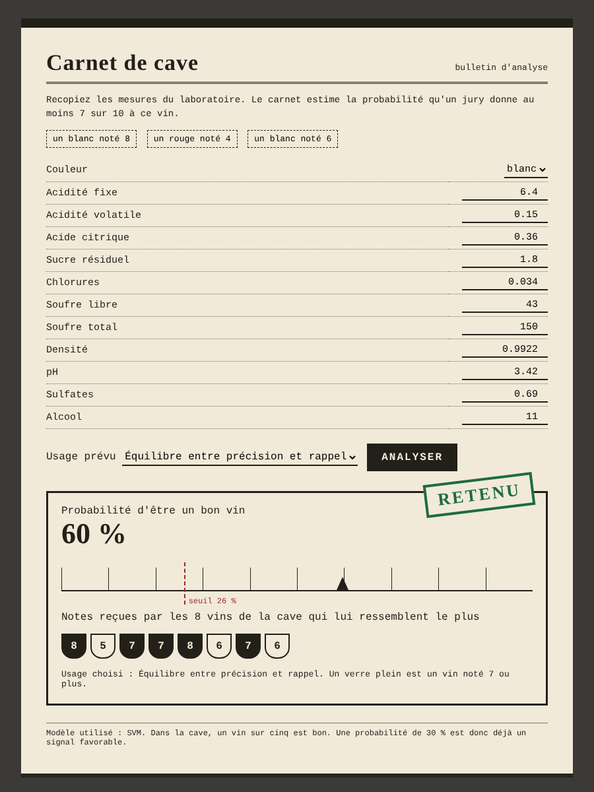

# Classification de la qualité du vin

Projet 2 du cours Machine Learning 1, EFREI 2026-2027, réalisé par Sabrina EL HASSANI, Florielle LODJO et Christina PAYONG.

Le but est de prédire si un vin est bon, c'est à dire noté au moins 7 sur 10 par des dégustateurs, à partir de 11 mesures de laboratoire et de sa couleur. Nous comparons les cinq modèles demandés, nous choisissons le meilleur, nous l'évaluons sur des vins qu'il n'a jamais vus et nous le rendons utilisable dans une application web.

**[Parcourir les notebooks avec le menu de navigation](https://elhsabrina.github.io/classification-qualite-vin/)**

## Sommaire

1. [Résultats](#résultats)
2. [Les notebooks](#les-notebooks)
3. [Sommaire détaillé des trois parties](#sommaire-détaillé-des-trois-parties)
4. [L'application web](#lapplication-web)
5. [Lancer le projet](#lancer-le-projet)
6. [Organisation du dépôt](#organisation-du-dépôt)
7. [Source des données](#source-des-données)

## Résultats

| | |
|---|---|
| Données | 6 497 vins portugais, 1 177 doublons supprimés, 5 320 vins distincts dont 19 % de bons |
| Modèle retenu | SVM à noyau gaussien, meilleure AUC moyenne sur 25 découpages (0,843 contre 0,840 pour les k plus proches voisins) |
| Seuil de décision | 0,26 au lieu de 0,5, choisi sur l'entraînement pour le meilleur F1-score |
| Sur le jeu de test | AUC 0,850, rappel 79 %, précision 46 %, soit 2,4 fois mieux que le hasard |

## Les notebooks

Le notebook **[projet_qualite_vin.ipynb](projet_qualite_vin.ipynb)** contient le code complet du projet, avec toutes ses sorties. C'est le livrable demandé. Il réunit les trois parties ci-dessous, que nous nous sommes réparties à trois et qui sont aussi disponibles séparément.

| Partie | Question | Notebook | Version .py |
|---|---|---|---|
| Partie 1 | Peut-on faire confiance aux données ? | [1_preparation.ipynb](1_preparation.ipynb) | [1_preparation.py](version_py/1_preparation.py) |
| Partie 2 | Comment construire et régler les cinq modèles ? | [2_modelisation.ipynb](2_modelisation.ipynb) | [2_modelisation.py](version_py/2_modelisation.py) |
| Partie 3 | Quel modèle choisir, et peut-on s'y fier ? | [3_evaluation.ipynb](3_evaluation.ipynb) | [3_evaluation.py](version_py/3_evaluation.py) |
| Complet | Les trois parties réunies | [projet_qualite_vin.ipynb](projet_qualite_vin.ipynb) | [projet_qualite_vin.py](version_py/projet_qualite_vin.py) |

Les notebooks se lancent dans l'ordre depuis la racine du dépôt. Chacun enregistre ce dont le suivant a besoin, la partie 1 les données préparées, la partie 2 les modèles réglés et la partie 3 le modèle final de l'application.

## Sommaire détaillé des trois parties

Chaque lien ouvre directement la section dans le site de navigation.

### Partie 1. Peut-on faire confiance aux données ?

Nettoyage, exploration, séparation entraînement et test, choix de préparation et sélection des mesures.

[1.1 Que contiennent les données ?](https://elhsabrina.github.io/classification-qualite-vin/notebooks/1_preparation.html#s1-1)  
[1.2 Manque-t-il des valeurs ?](https://elhsabrina.github.io/classification-qualite-vin/notebooks/1_preparation.html#s1-2)  
[1.3 Qu'est-ce qu'un bon vin, et pourquoi l'accuracy ne suffit-elle pas ?](https://elhsabrina.github.io/classification-qualite-vin/notebooks/1_preparation.html#s1-3)  
[1.4 Quels vins garde-t-on pour le test final ?](https://elhsabrina.github.io/classification-qualite-vin/notebooks/1_preparation.html#s1-4)  
[1.5 Qu'est-ce qui distingue un bon vin ?](https://elhsabrina.github.io/classification-qualite-vin/notebooks/1_preparation.html#s1-5)  
[1.6 Des mesures disent-elles la même chose ?](https://elhsabrina.github.io/classification-qualite-vin/notebooks/1_preparation.html#s1-6)  
[1.7 Comment vérifier nos choix sans toucher au test ?](https://elhsabrina.github.io/classification-qualite-vin/notebooks/1_preparation.html#s1-7)  
[1.8 Faut-il supprimer les doublons ?](https://elhsabrina.github.io/classification-qualite-vin/notebooks/1_preparation.html#s1-8)  
[1.9 Faut-il retirer les valeurs extrêmes ?](https://elhsabrina.github.io/classification-qualite-vin/notebooks/1_preparation.html#s1-9)  
[1.10 Faut-il mettre les mesures à la même échelle ?](https://elhsabrina.github.io/classification-qualite-vin/notebooks/1_preparation.html#s1-10)  
[1.11 Faut-il retirer des mesures ?](https://elhsabrina.github.io/classification-qualite-vin/notebooks/1_preparation.html#s1-11)  

### Partie 2. Comment construire et régler les cinq modèles ?

Régression logistique, k plus proches voisins, arbre de décision, Naive Bayes et SVM, réglage, biais et variance.

[2.1 Quels sont les cinq modèles, et lesquels sont linéaires ?](https://elhsabrina.github.io/classification-qualite-vin/notebooks/2_modelisation.html#s2-1)  
[2.2 Que donnent-ils sans réglage ?](https://elhsabrina.github.io/classification-qualite-vin/notebooks/2_modelisation.html#s2-2)  
[2.3 Comment choisir les hyperparamètres ?](https://elhsabrina.github.io/classification-qualite-vin/notebooks/2_modelisation.html#s2-3)  
[2.4 Pourquoi régler avec l'AUC plutôt qu'avec le F1 ?](https://elhsabrina.github.io/classification-qualite-vin/notebooks/2_modelisation.html#s2-4)  
[2.5 La recherche aléatoire fait-elle aussi bien ?](https://elhsabrina.github.io/classification-qualite-vin/notebooks/2_modelisation.html#s2-5)  
[2.6 Comment éviter un modèle trop rigide ou trop collé aux données ?](https://elhsabrina.github.io/classification-qualite-vin/notebooks/2_modelisation.html#s2-6)  
[2.7 Qu'a appris chaque modèle ?](https://elhsabrina.github.io/classification-qualite-vin/notebooks/2_modelisation.html#s2-7)  
[2.8 Combiner les modèles aide-t-il ?](https://elhsabrina.github.io/classification-qualite-vin/notebooks/2_modelisation.html#s2-8)  

### Partie 3. Quel modèle choisir, et peut-on s'y fier ?

Choix du modèle sur 25 découpages, seuil de décision, test final, erreurs, usages et limites.

[3.1 Quel modèle est le meilleur, et sur quoi se base-t-on ?](https://elhsabrina.github.io/classification-qualite-vin/notebooks/3_evaluation.html#s3-1)  
[3.2 Que donne le modèle, et à partir de quelle probabilité dit-on « bon » ?](https://elhsabrina.github.io/classification-qualite-vin/notebooks/3_evaluation.html#s3-2)  
[3.3 Que vaut-il sur des vins qu'il n'a jamais vus ?](https://elhsabrina.github.io/classification-qualite-vin/notebooks/3_evaluation.html#s3-3)  
[3.4 Est-il aussi bon sur les rouges que sur les blancs ?](https://elhsabrina.github.io/classification-qualite-vin/notebooks/3_evaluation.html#s3-4)  
[3.5 Où se trompe-t-il, et pourquoi ?](https://elhsabrina.github.io/classification-qualite-vin/notebooks/3_evaluation.html#s3-5)  
[3.6 Quel seuil pour quel usage ?](https://elhsabrina.github.io/classification-qualite-vin/notebooks/3_evaluation.html#s3-6)  
[3.7 Quelles sont les limites ?](https://elhsabrina.github.io/classification-qualite-vin/notebooks/3_evaluation.html#s3-7)  
[3.8 Que retenir de tout le projet ?](https://elhsabrina.github.io/classification-qualite-vin/notebooks/3_evaluation.html#s3-8)  

## L'application web

L'application **Carnet de cave** met le modèle final entre les mains de quelqu'un qui ne code pas, par exemple un caviste. On saisit les 11 mesures d'un vin et sa couleur, puis on choisit son usage parmi trois. L'application affiche la probabilité que le vin soit bon, la décision selon le seuil de cet usage et les notes des huit vins les plus ressemblants de notre base, ce qui permet de justifier la réponse.

| Usage | Seuil | Ce que l'on cherche |
|---|---|---|
| Présélection avant dégustation | 0,10 | Ne rater presque aucun bon vin |
| Équilibre | 0,26 | Le meilleur compromis entre précision et rappel |
| Label prestige | 0,72 | Ne récompenser que des vins très sûrs |

<p align="center"></p>

Une route `/api/predire` permet aussi d'obtenir la prédiction au format JSON.

## Lancer le projet

Avec Docker, l'image installe les bibliothèques, réentraîne le modèle et lance l'application.

```bash
docker build -t qualite-vin .
docker run -p 5000:5000 qualite-vin
```

Sans Docker

```bash
pip install -r requirements.txt
python -m src.entrainement
python app/app.py
```

L'application est ensuite disponible sur http://localhost:5000

Les 12 tests unitaires vérifient le chargement des données, la suppression des doublons, la séparation sans vin commun entre entraînement et test, le modèle et l'application.

```bash
pytest
```

## Organisation du dépôt

| Dossier ou fichier | Contenu |
|---|---|
| `projet_qualite_vin.ipynb` | le notebook complet, déjà exécuté |
| `1_preparation.ipynb, 2_modelisation.ipynb, 3_evaluation.ipynb` | les trois parties, déjà exécutées |
| `version_py/` | les mêmes notebooks au format .py |
| `data/` | les deux fichiers de données d'origine |
| `donnees_preparees/` | les jeux d'entraînement et de test créés par la partie 1 |
| `modeles/` | les cinq modèles réglés par la partie 2 |
| `src/` | le code de préparation et d'entraînement réutilisé par l'application |
| `app/` | l'application web Flask et son modèle final |
| `tests/` | les 12 tests unitaires |
| `figures/` | les figures des notebooks |
| `docs/` | le site de navigation des notebooks |
| `Dockerfile, requirements.txt` | l'environnement pour reproduire le projet |

## Source des données

P. Cortez, A. Cerdeira, F. Almeida, T. Matos et J. Reis. Modeling wine preferences by data mining from physicochemical properties. Decision Support Systems, 47(4), 547-553, 2009.
